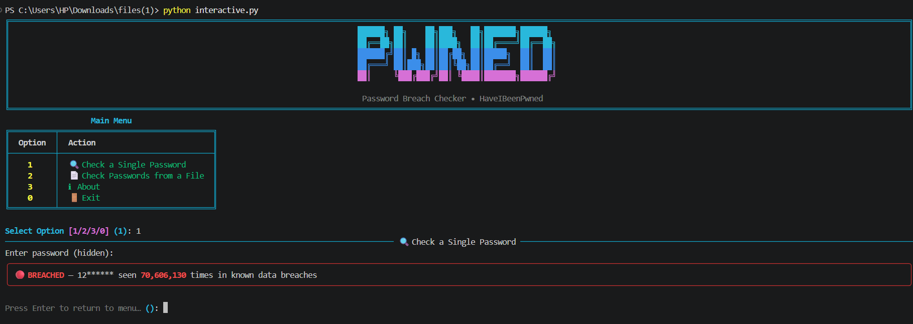
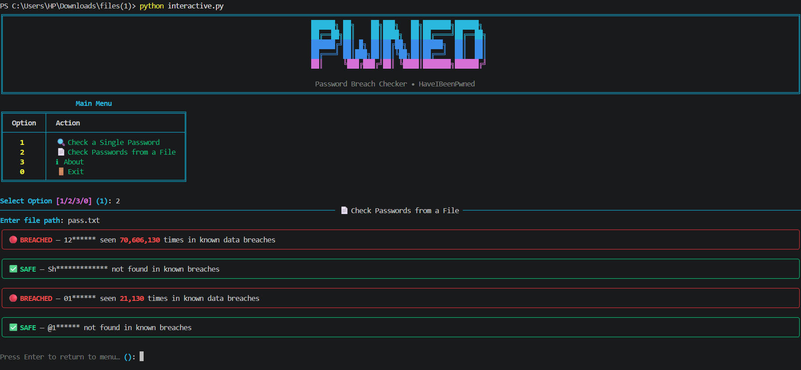
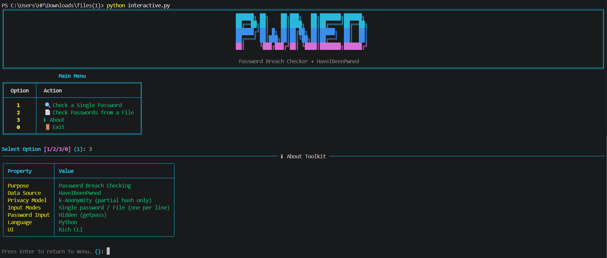
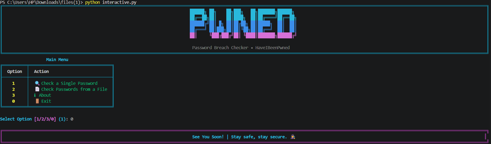

# 🛡️ Password-Breach-Checker 🔐

A Python-based **Password Breach Checker** Command Line Tool that lets you check whether your passwords have appeared in **known data breaches** using the **HaveIBeenPwned (Pwned Passwords) API**, right from your terminal.

This CLI tool is built for **everyday account security**, **learning k-anonymity in practice**, and **CTF/security practice**, combining a **simple menu-driven mode**, an **argument-based CLI**, and a **rich, colorful interactive CLI**.

---

## 🧱 Project Structure

```bash
password-breach-checker-python/
│
├── assets/              # Screenshots
├── core/                # Core breach-checking logic
│   ├── __init__.py
│   └── checker.py       # SHA-1 hashing, API request & password masking
├── main.py              # Basic CLI application
├── parser.py            # Argument-based CLI Version
├── interactive.py       # Rich CLI Version
├── requirements.txt     # Project Dependencies
├── LICENSE              # Project license
└── README.md            # Project documentation
```

---

## ✨ Features

### 🔍 Breach Checking

- Checks passwords against the **HaveIBeenPwned Pwned Passwords** database
- Shows **how many times** a password has appeared in known breaches
- Supports checking a **single password** or **multiple passwords from a file** (one per line)
- Clear **BREACHED / SAFE** result for every password

### 🔒 Privacy-First Design (k-Anonymity)

- Password is hashed locally with **SHA-1** — the plaintext never leaves your machine
- Only the **first 5 characters** of the hash are sent to the API
- The remaining hash suffix is matched **locally** against the API response
- Passwords are **masked** in the output (e.g. `my********`)
- Single password input is **hidden** using `getpass`

### ⌨️ Argparse CLI (`parser.py`)

- Non-interactive, flag-based checking — great for scripting and automation
- `-p`, `--pass`, `--password` flag for a single password (hidden prompt)
- `-f`, `--file` flag for checking passwords from a file
- `--json` flag for **JSON output**

### 🎨 Rich CLI Interface

- Colored terminal output with a custom banner
- Structured **About** table showing tool properties
- Styled panels — 🔴 red for breached, ✅ green for safe
- Handles empty input, empty files, missing files, and API errors gracefully

### ⚡ Triple Mode Support

- 🧼 Basic CLI → Simple, menu-driven (`main.py`)
- ⌨️ Argparse CLI → Flag-based, script-friendly, JSON output (`parser.py`)
- 🎨 Rich CLI → Enhanced UI with colors, panels and menus (`interactive.py`)

---

## 🛠 Technologies Used

| Technology   | Purpose                                 |
| ------------ | --------------------------------------- |
| **Python 3** | Core language                           |
| **hashlib**  | SHA-1 hashing of passwords              |
| **requests** | HTTP requests to the HaveIBeenPwned API |
| **getpass**  | Hidden password input                   |
| **argparse** | Flag-based CLI argument parsing         |
| **json**     | JSON output format                      |
| **Rich**     | Interactive CLI interface               |

---

## ▶️ How to Run

### 1️⃣ Clone the repository

```bash
git clone https://github.com/ShakalBhau0001/password-breach-checker-python.git
```

### 2️⃣ Enter the project directory

```bash
cd password-breach-checker-python
```

### 3️⃣ Install Dependencies

```bash
pip install rich requests
```

**OR**

```bash
pip install -r requirements.txt
```

> ℹ️ `requests` is required for all three modes (API calls) — Rich is only required for `interactive.py`.

### 4️⃣ Running the Project

#### Basic CLI Version

```bash
python main.py
```

#### Argparse CLI Version

```bash
python parser.py -p
python parser.py --password
python parser.py -f passwords.txt
python parser.py --file passwords.txt --json
```

#### Rich Interactive Version

```bash
python interactive.py
```

---

## ▶️ Usage

### Basic CLI (`main.py`)

```bash
============================================================
  🔐 PASSWORD BREACH CHECKER
============================================================

Checks passwords against known data breaches (HaveIBeenPwned)
Your password is never sent in full — only a partial hash.

------------------------------------------------------------
Options:
1. Check a single password
2. Check passwords from a file (one per line)
3. Exit

Choice (1-3): 1
Enter password (hidden):

  🔴 BREACHED — pa******* seen 10,434,004 times in known data breaches
```

```bash
Choice (1-3): 2
Enter file path: passwords.txt

  🔴 BREACHED — ab****** seen 2,345 times in known data breaches

  ✅ SAFE — Xk************ not found in known breaches
```

### Argparse CLI (`parser.py`)

#### 1. Check a single password

```bash
python parser.py -p
```

```bash
python parser.py --password
```

#### 2. Check passwords from a file

```bash
python parser.py -f passwords.txt
```

```bash
python parser.py --file passwords.txt
```

#### 3. JSON output

```bash
python parser.py -p --json
```

```bash
python parser.py -f passwords.txt --json
```

```json
{
  "password": "pa*******",
  "breach_count": 10434004
}
```

### Rich Interactive CLI (`interactive.py`)

```bash
[1] 🔍 Check a Single Password
[2] 📄 Check Passwords from a File
[3] ℹ About
[0] 🚪 Exit

Select Option: 1
Enter password (hidden):

🔴 BREACHED — pa******* seen 10,434,004 times in known data breaches
```

---

## 📁 Supported Input

- **Single Password:** Entered via a hidden prompt (`getpass`)
- **Password File:** Plain text file with **one password per line** (blank lines are skipped)
- **Output Formats:** Formatted text (all modes) and JSON (`parser.py --json`)
- **Internet Connection:** Required (API call to `api.pwnedpasswords.com`)

> ⚠️ Passwords inside the input file are stored in plain text on your disk — delete the file after use.

---

## ⚙️ How It Works

**1️⃣ Hashing**

- Password is encoded as UTF-8 and hashed with **SHA-1** locally
- Hash is converted to uppercase hex and split into a **5-character prefix** and the remaining **suffix**

**2️⃣ k-Anonymity API Request**

- Only the 5-character **prefix** is sent to `https://api.pwnedpasswords.com/range/<prefix>`
- The API returns all hash suffixes (with breach counts) that share that prefix

**3️⃣ Local Matching**

- Each returned line (`SUFFIX:COUNT`) is compared with your password's suffix **locally**
- Match found → password is **BREACHED** with its breach count
- No match → password is **SAFE** (not found in known breaches)

**4️⃣ Masking**

- Only the first 2 characters of the password are shown in output; the rest is replaced with `*`

---

## ⚠️ Common Errors

- **API request failed** → Non-200 response from the API (`RuntimeError` with status code)
- **No internet connection / timeout** → Request to the API fails (10 second timeout)
- **File not found** → Wrong file path in file mode
- **No password entered** → Empty input is rejected with an error message
- **Missing required flag** (Argparse CLI) → `argparse` prints usage and exits (use either `-p` or `-f`)

---

## 🌟 Future Enhancements

- Graceful handling of network errors (`requests.exceptions`) with a friendly message
- Export results to a CSV/JSON file
- Add a password strength / entropy estimate alongside breach status
- Add a small delay or session reuse when checking very large password files
- Email breach checking support

---

## 📦 Related Projects

This repository focuses on a **specific privacy-preserving technique (k-Anonymity)** implemented
as a **command-line (CLI) learning project**.

The goal of this project is to:

- Understand how breached-password checking works without exposing the password
- Practice working with **REST APIs** and **hashing** in Python
- Learn how simple CLI-based security tools are structured

For more advanced, security-focused CLI tools, check out:

> 🔗 **[CLI Projects](https://github.com/stars/ShakalBhau0001/lists/cli-projects)**

---

## ⚠️ Disclaimer

> This project is intended for **educational and learning purposes only**.

> _Even though only a partial hash is sent to the API, avoid entering real, sensitive passwords on shared or untrusted machines. A "SAFE" result only means the password was not found in the known breach database — it does not guarantee that the password is strong._

---

## 📸 Preview

### 1. **Check Password**



### 2. **Check From File**



### 3. **About**



### 4. **Exit**



---

## 🪪 Author

> **Creator: Shakal Bhau**

> **GitHub: [ShakalBhau0001](https://github.com/ShakalBhau0001)**

---

## ⭐ Support

If you like this project, consider giving it a ⭐ on GitHub!

---
